# Roteiro 3 — Investigação de segurança em aplicações web

**Disciplina:** Tecnologias Hackers — Insper

**Aluno:** [preencher]

**Data dos testes:** 10/11/2026

## 1. Ambiente e metodologia

O laboratório foi executado em uma máquina virtual Kali GNU/Linux Rolling 2026.2, com o OWASP WebGoat v2025.3 no contêiner Docker `webgoat-lab`. As portas 8080 (WebGoat) e 9090 (WebWolf) foram publicadas em `127.0.0.1`. O acesso ao WebGoat foi feito pelo Firefox, configurado para usar o Burp Suite Community Edition v2026.8 como proxy na porta 8081. O terminal registrou HTTP 302 para o caminho inicial, e o histórico do Burp confirmou que o fluxo chegou à tela de login com HTTP 200 (E01–E03).

No Burp, uma requisição inicial foi capturada em **Proxy → Intercept**, encaminhada e examinada em **HTTP history** junto com a resposta. O **Repeater** foi usado para comparar respostas ao remover o cookie, reutilizá-lo após logout e alterar o identificador de um perfil. A análise considerou os cabeçalhos, o corpo e os redirecionamentos, além do código HTTP.

## 2. Análise da comunicação HTTP

| Campo | Abertura da tela de login (E03) | Envio do cadastro (E04) |
|---|---|---|
| Método e caminho | `GET /WebGoat/login` | `POST /WebGoat/register.mvc` |
| Parâmetros | Sem parâmetros na URL ou no corpo | `username`, `password`, `matchingPassword` e `agree` no corpo |
| Cabeçalhos | `Host`, `User-Agent` e `Accept` | `Content-Type: application/x-www-form-urlencoded`, `Origin` e `Referer` |
| Cookie enviado | `JSESSIONID` | `JSESSIONID` |
| Resposta | HTTP 200, corpo HTML com a página de login | HTTP 302, `Location` para `/WebGoat/attack?username=teste1`, `Set-Cookie` e corpo vazio |

O GET pede o HTML da tela. O POST envia dados para o servidor processar o cadastro. O cliente fornece o método, o caminho, os parâmetros e os cabeçalhos. O servidor decide se os dados são válidos, se deve criar uma sessão e qual resposta enviar. Como o cliente pode editar esses dados antes do envio, o servidor precisa validar tanto os valores recebidos quanto as permissões da identidade associada à sessão.

## 3. Autenticação e sessão

Foi utilizada a conta fictícia `teste1`. A requisição do cadastro bem-sucedido já levava um `JSESSIONID`, e sua resposta definiu outro valor. A requisição autenticada ao recurso `/WebGoat/start.mvc?username=teste1` enviou o novo identificador e recebeu o HTML da aplicação (E04–E05). A troca reduz o risco de fixação de sessão, pois um identificador conhecido antes da autenticação não deve passar a dar acesso à sessão autenticada. A comparação documenta a troca durante o fluxo de cadastro com entrada automática. A renovação no POST de login separado ainda precisa de evidência própria, caso seja testada.

O `Set-Cookie` do cadastro apresenta `Path=/WebGoat` e `HttpOnly`. Os atributos `Secure` e `SameSite` não aparecem nesse cabeçalho. A captura foi feita em HTTP local.

Com a sessão válida, o Repeater recebeu HTTP 200 com o HTML da área autenticada. Ao retirar o cookie, o mesmo caminho redirecionou para `/WebGoat/login`. Após logout, reenviar o identificador anterior também levou à tela de login (E05–E07). A comparação mostra que o parâmetro `username` sozinho não manteve o acesso e que o identificador anterior deixou de dar acesso ao recurso testado após o logout.

## 4. Autorização e investigação aprofundada

**Hipótese.** Na lição *Insecure Direct Object References* (IDOR), uma sessão com acesso ao perfil de Tom Cat poderia ler o perfil de outra identidade se o servidor aceitasse o ID fornecido na URL sem conferir a permissão sobre aquele perfil.

**Método.** O perfil próprio retornou o ID `2342384` e o campo `role` no JSON (E08). A lição confirmou a rota alternativa com o ID do perfil próprio (E09). No Repeater, foi usado o caminho `GET /WebGoat/IDOR/profile/{userId}` com a sessão da lição. A tentativa com `2342385` retornou HTTP 200 com `lessonCompleted: false` e sem dados de perfil (E10). Em seguida, a requisição usou `2342388`, mantendo a sessão (E11).

**Resultado esperado.** O servidor deveria permitir a leitura do perfil próprio e impedir que Tom Cat recebesse os dados de Buffalo Bill sem permissão para aquele perfil.

**Resultado observado.** Para `2342388`, a resposta foi HTTP 200 com `lessonCompleted: true` e retornou o perfil de Buffalo Bill, incluindo nome, ID, papel e outros atributos. A comparação com E10 mostra por que o status 200 isolado não resolve o teste. A evidência da leitura indevida está no conteúdo da resposta E11.

**Conclusão e recomendação.** A leitura do perfil alheio confirma uma falha de autorização por objeto no cenário da lição. Uma sessão válida estabelece a identidade do usuário, e o servidor ainda precisa verificar se ela tem permissão sobre o objeto solicitado. A correção é aplicar essa verificação no servidor a cada leitura ou alteração de perfil e restringir os campos retornados aos necessários para a operação.

## 5. Matriz de testes

| Identidade ou sessão | Recurso e operação | Esperado | Observado | Evidência | Classificação |
|---|---|---|---|---|---|
| `teste1`, sessão válida | GET `/WebGoat/start.mvc?username=teste1` | Acesso permitido | 200 e HTML da área autenticada | E05 | Esperado |
| Sem cookie | Mesmo GET | Exigir autenticação | 302 para o login | E06 | Esperado |
| Cookie anterior, após logout | Mesmo GET | Negar o acesso com a sessão encerrada | 302 para o login | E07 | Esperado |
| Tom Cat, sessão da lição | Leitura do próprio perfil | Acesso permitido | JSON do próprio perfil e confirmação da rota alternativa | E08, E09 | Esperado |
| Tom Cat, sessão da lição | GET `/WebGoat/IDOR/profile/2342385` | Sem dados de perfil alheio | 200, tentativa rejeitada e sem dados de perfil | E10 | Sem exposição nesse teste |
| Tom Cat, sessão da lição | GET `/WebGoat/IDOR/profile/2342388` | Negar a leitura do perfil alheio | 200 e dados do perfil de Buffalo Bill | E11 | Vulnerabilidade confirmada |

## 6. Pendências para a próxima revisão

- Testar o mesmo endpoint de perfil sem o cookie de sessão e registrar o resultado.
- Verificar se a lição permite acessar o perfil de Buffalo Bill pela identidade autorizada. Se for possível, capturar a resposta para compará-la com E11.
- Complementar a análise de renovação do cookie com a requisição e resposta do login separado, se disponíveis.
- Salvar no Burp os pares de requisição e resposta usados na matriz e associá-los aos identificadores abaixo. Os anexos atuais são capturas de tela.
- Preencher o nome do aluno. Para a demonstração prática, usar o Intercept e reproduzir a troca de ID no Repeater, explicando o conteúdo da resposta.

## 7. Evidências

**E01 — Ambiente Kali e Docker**

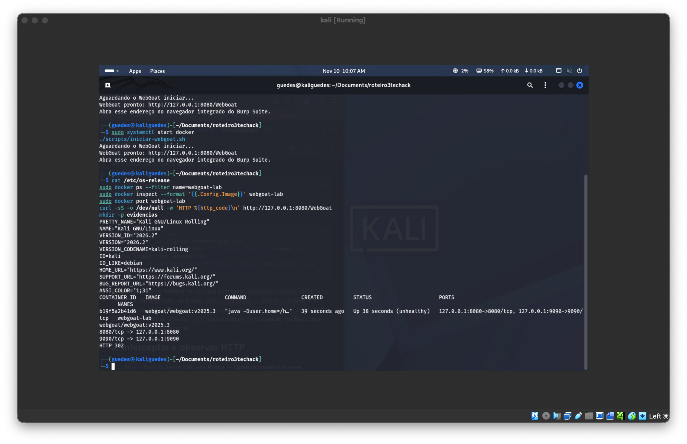

**E02 — Interceptação do GET inicial**

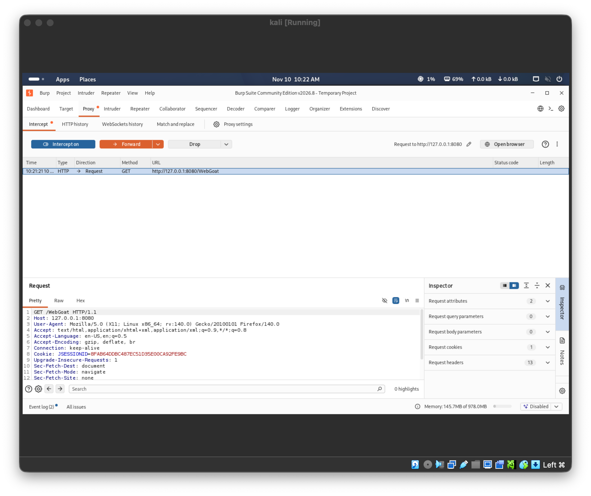

**E03 — Tela de login e resposta HTML**

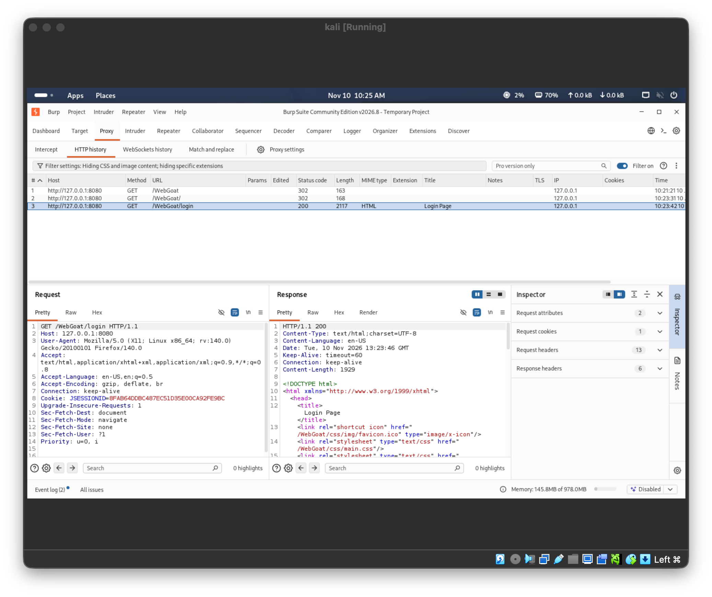

**E04 — Cadastro e emissão de novo cookie**

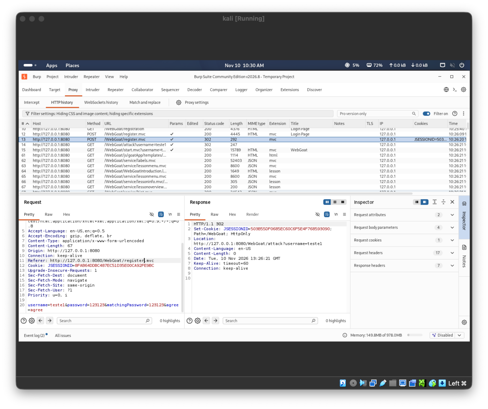

**E05 — Sessão válida no Repeater**

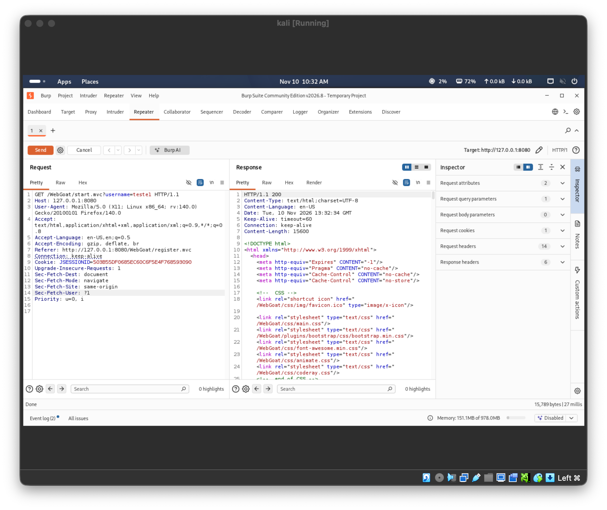

**E06 — Requisição sem cookie**

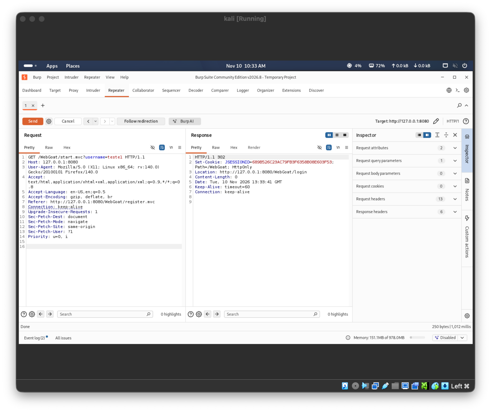

**E07 — Reutilização do cookie após logout**

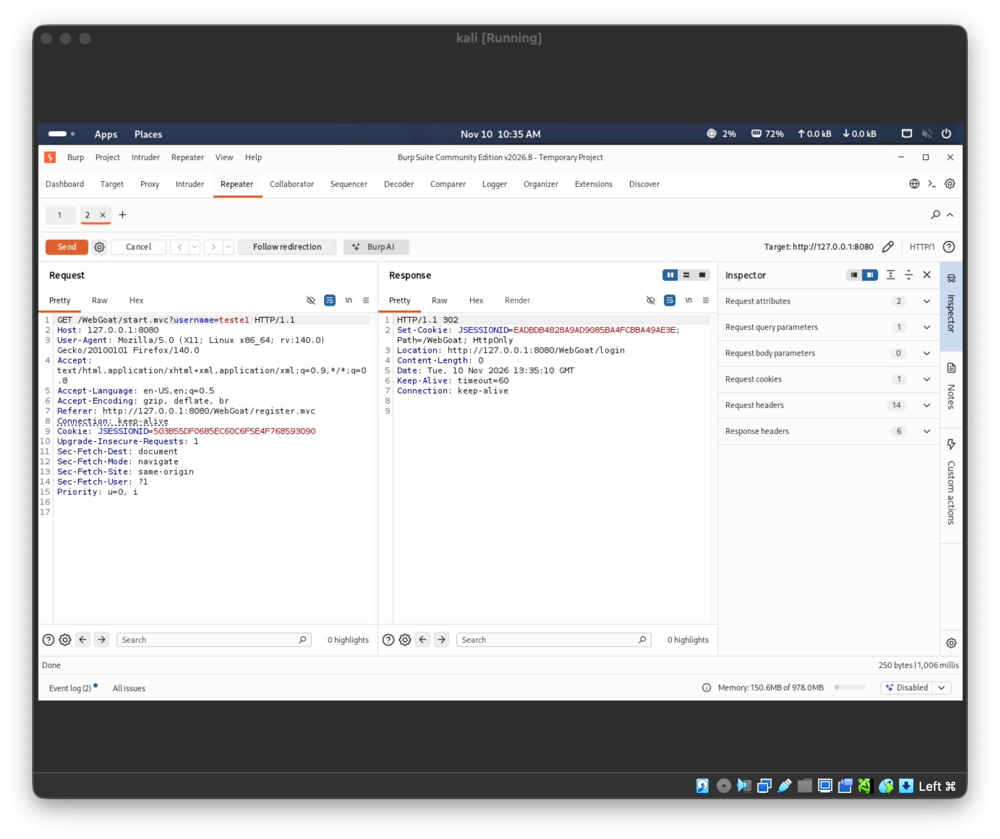

**E08 — JSON do perfil próprio**

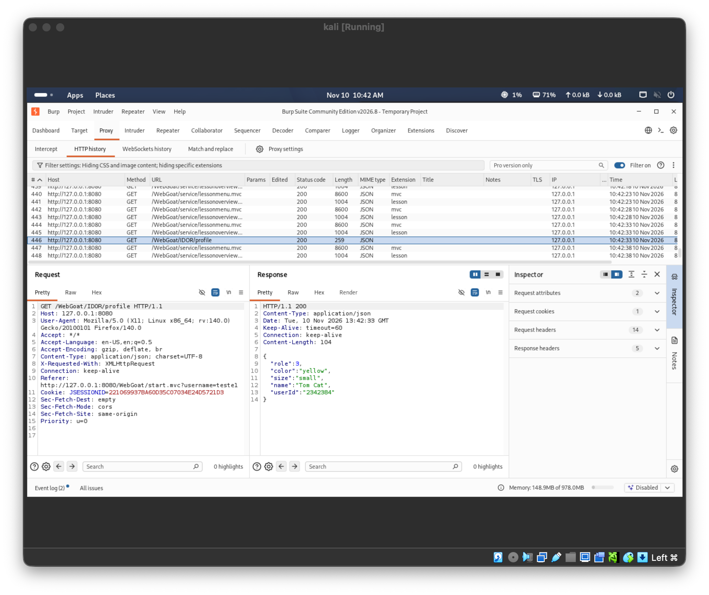

**E09 — Confirmação da rota alternativa**

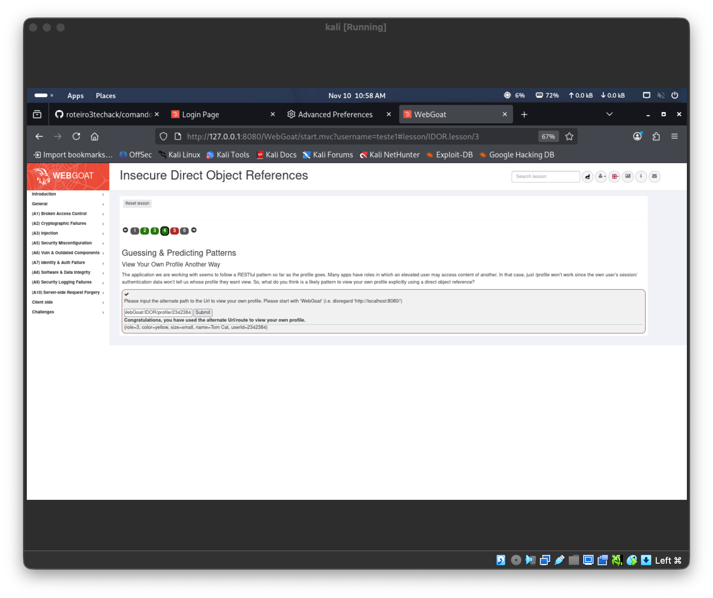

**E10 — Tentativa com ID 2342385**

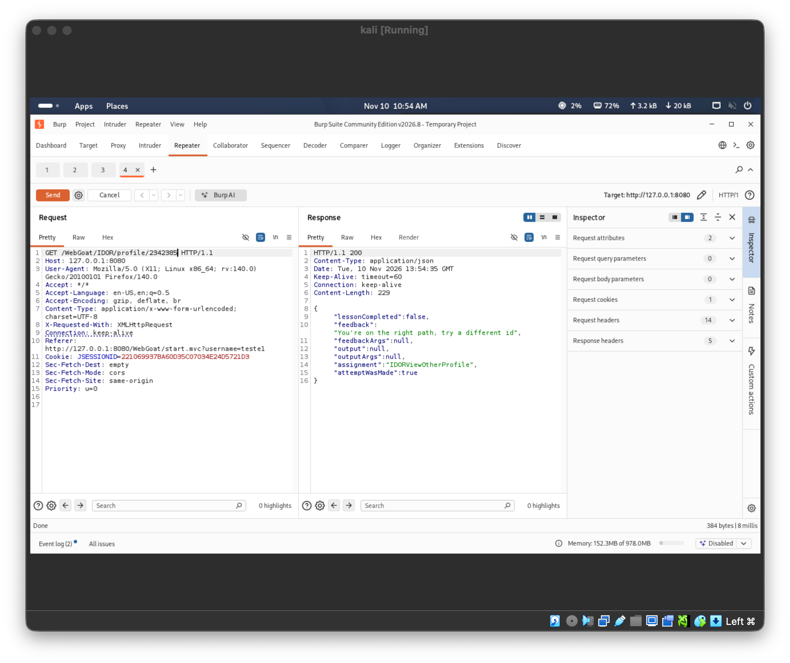

**E11 — Leitura do perfil de Buffalo Bill**

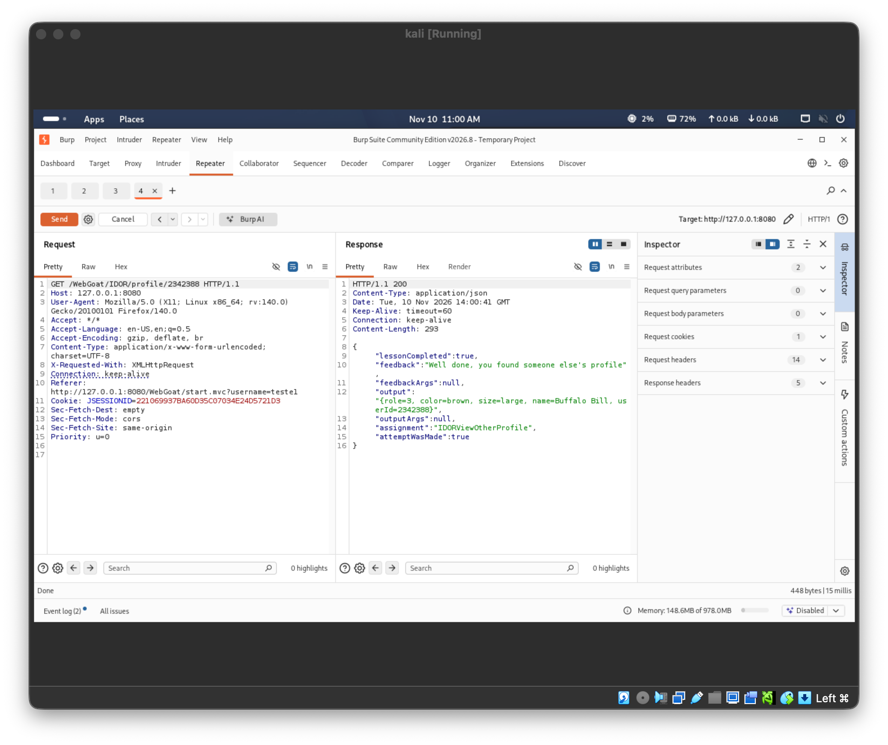
