# Roteiro 3 — Investigação de segurança em aplicações web

**Disciplina:** Tecnologias Hackers — Insper  
**Aluno:** Guilherme Galvão Guedes  
**Data dos testes:** 10/11/2026  
**Aplicação:** OWASP WebGoat v2025.3  
**Ferramenta principal:** Burp Suite Community Edition v2026.8

## Resumo executivo

O laboratório investigou comunicação HTTP, autenticação, gerenciamento de sessão e autorização no OWASP WebGoat, executado localmente em uma máquina virtual Kali Linux. Foram observadas a interceptação de requisições pelo Burp Suite, a emissão de um novo identificador `JSESSIONID` durante o cadastro com entrada automática, a exigência de sessão válida para acessar a aplicação e a impossibilidade de reutilizar o cookie anterior após o logout, no recurso examinado.

Na lição *Insecure Direct Object References* (IDOR), uma sessão que consultava o perfil de Tom Cat (`userId=2342384`) conseguiu recuperar dados de Buffalo Bill ao substituir o identificador na URL por `2342388`. O conteúdo da resposta confirma a falha de autorização por objeto no cenário didático. Em contraste, a tentativa com `2342385` não expôs outro perfil, embora também tenha retornado HTTP 200. Portanto, a classificação considerou o corpo e os cabeçalhos das respostas, e não apenas o status HTTP. As conclusões se restringem aos testes descritos e ao ambiente de laboratório.

## 1. Ambiente e preparação

O laboratório foi executado em uma máquina virtual **Kali GNU/Linux Rolling 2026.2**, com o **OWASP WebGoat v2025.3** no contêiner Docker `webgoat-lab`. As portas do WebGoat (`8080`) e do WebWolf (`9090`) foram publicadas somente na interface de loopback `127.0.0.1`, impedindo a exposição direta da aplicação vulnerável a outras máquinas pela publicação dessas portas.

| Componente | Configuração utilizada | Função |
|---|---|---|
| Sistema operacional | Kali GNU/Linux Rolling 2026.2 (VM) | Ambiente isolado dos testes |
| Alvo | OWASP WebGoat v2025.3 | Aplicação intencionalmente vulnerável |
| Contêiner | `webgoat-lab` (Docker) | Execução local do alvo |
| Endereços | `http://127.0.0.1:8080/WebGoat` e porta `9090` para WebWolf | Serviços acessíveis em loopback |
| Navegador | Firefox | Interação com a aplicação |
| Proxy | Burp Suite Community Edition v2026.8, porta `8081` | Interceptação, inspeção e repetição de HTTP |

Os registros iniciais mostram HTTP 302 na abertura da aplicação e, após o redirecionamento, HTTP 200 na tela de login (E01–E03). O navegador foi configurado para encaminhar o tráfego ao Burp, inclusive o tráfego dirigido a `127.0.0.1`. A captura da requisição pelo **Proxy → Intercept**, seu encaminhamento (**Forward**) e a inspeção da resposta em **HTTP history** verificam o funcionamento do fluxo navegador → proxy → servidor → proxy → navegador.

**Restrição de escopo:** os testes foram efetuados no WebGoat local. Os resultados não demonstram a existência das mesmas vulnerabilidades em serviços externos nem em outras versões da aplicação.

## 2. Metodologia e critérios de avaliação

Os testes seguiram uma abordagem comparativa, adequada às etapas de HTTP, sessão e autorização do roteiro:

1. Definir a regra de segurança a ser verificada e o comportamento esperado.
2. Observar uma requisição de referência e sua resposta no Burp (método, caminho, parâmetros, cabeçalhos, cookie, código, redirecionamento e corpo).
3. Reenviar a requisição pelo **Repeater**, modificando uma condição por vez: presença ou validade do cookie, ou identificador do recurso.
4. Comparar as respostas, especialmente `Location`, `Set-Cookie`, código HTTP e **conteúdo efetivamente retornado**.
5. Classificar cada resultado como comportamento esperado, configuração inadequada, vulnerabilidade confirmada ou inconclusivo/sem exposição demonstrada.
6. Relacionar a conclusão à evidência correspondente (E01–E11).

Um status `200 OK` não comprova, isoladamente, acesso indevido: pode acompanhar tanto dados efetivamente expostos quanto uma mensagem da própria lição indicando tentativa malsucedida. Da mesma forma, um `302 Found` exige observar o cabeçalho `Location` para identificar o destino. Esse cuidado é central para diferenciar a existência de uma falha real de um simples comportamento HTTP.

## 3. Observação e análise da comunicação HTTP

### 3.1. Comparação de funcionalidades diferentes

Foram comparados a abertura da tela de login e o envio de dados de cadastro:

| Elemento | Tela de login (E03) | Cadastro (E04) |
|---|---|---|
| Método | `GET` | `POST` |
| Caminho | `/WebGoat/login` | `/WebGoat/register.mvc` |
| Parâmetros | Sem parâmetros na URL ou no corpo | `username`, `password`, `matchingPassword`, `agree` no corpo |
| Cabeçalhos relevantes | `Host`, `User-Agent`, `Accept` | `Content-Type: application/x-www-form-urlencoded`, `Origin`, `Referer` |
| Cookie enviado | `JSESSIONID` | `JSESSIONID` |
| Resposta HTTP | `200 OK` | `302 Found` |
| Corpo / efeito | HTML da tela de login | Corpo vazio e redirecionamento para `/WebGoat/attack?username=teste1` |
| Cabeçalho decisivo na resposta | Tipo e conteúdo do HTML | `Location` e `Set-Cookie` |
| Finalidade | Solicitar uma página | Submeter dados para processamento e estabelecer fluxo de acesso |

O `GET` solicita a representação de um recurso; o `POST` transmite informações para processamento. O navegador controla os elementos da requisição que envia, como método, rota, parâmetros, cabeçalhos e cookies. O servidor, por sua vez, deve decidir se os dados são válidos, qual identidade está associada ao identificador de sessão e que operações podem ser executadas.

### 3.2. Por que o servidor não pode confiar nos dados do cliente?

O navegador não é uma fronteira de confiança: uma requisição pode ser alterada no Burp antes de chegar ao servidor, independentemente das restrições da interface gráfica. Por exemplo, um atacante pode trocar o identificador de um perfil em uma URL mantendo o cookie de uma sessão autenticada. Por isso, validar apenas que o usuário está logado não é suficiente: o servidor precisa validar **a autorização para o recurso específico** em cada operação. O teste E11 demonstra a consequência da ausência dessa verificação na lição IDOR.

## 4. Investigação de autenticação e gerenciamento de sessão

### 4.1. Autenticação e identificação de sessão

Foi utilizada a conta fictícia `teste1`. Na captura do **cadastro bem-sucedido** (E04), o cliente já enviava um `JSESSIONID`, enquanto a resposta apresentou um novo `Set-Cookie`. A requisição subsequente para `/WebGoat/start.mvc?username=teste1` utilizou o identificador novo e recebeu HTTP 200 com o HTML da área autenticada (E05).

| Condição | Observação | Evidência |
|---|---|---|
| Antes de concluir o cadastro | Requisição já continha `JSESSIONID` | E04 |
| Resposta ao cadastro | Novo valor de `JSESSIONID` em `Set-Cookie` e redirecionamento | E04 |
| Acesso subsequente autenticado | Novo cookie enviado; HTTP 200 e conteúdo autenticado | E05 |

**Interpretação:** houve troca do identificador no fluxo de cadastro seguido de entrada automática. A troca é relevante para mitigar **fixação de sessão (*session fixation*)**: caso um atacante conheça ou imponha um identificador antes da autenticação, esse valor não deveria adquirir os privilégios da sessão autenticada. A análise se concentra na renovação do identificador observada durante o cadastro com entrada automática.

Se o identificador permanecesse igual após autenticação, isso exigiria testes adicionais antes de declarar vulnerabilidade: verificar se um identificador pré-definido por terceiro é aceito pelo servidor e se continua associado à identidade autenticada após o login.

### 4.2. Atributos do cookie

O cabeçalho `Set-Cookie` observado no cadastro contém `Path=/WebGoat` e `HttpOnly`; não exibe `Secure` nem `SameSite` (E04).

| Atributo | Na resposta examinada | Implicação de segurança |
|---|---|---|
| `Path=/WebGoat` | Presente | Limita o caminho no qual o navegador envia o cookie; não substitui autorização no servidor |
| `HttpOnly` | Presente | Impede a leitura direta do cookie por JavaScript, reduzindo uma via de exfiltração em cenários de XSS |
| `Secure` | Não observado | Em produção sobre HTTPS, deve ser empregado para restringir envio a conexões seguras |
| `SameSite` | Não observado | Uma política explícita adequada ao fluxo da aplicação ajuda a mitigar determinados cenários de CSRF; a ausência no cabeçalho não permite concluir que todo navegador enviará o cookie irrestritamente |

O laboratório utiliza HTTP em loopback, de modo que a análise dos atributos não equivale a uma avaliação de implantação pública com HTTPS. Os atributos são analisados como medidas de proteção de sessão, sem confundir sua configuração com uma exploração efetiva.

### 4.3. Comparação de três condições no Repeater

A mesma operação autenticada, `GET /WebGoat/start.mvc?username=teste1`, foi examinada sob três condições:

| Condição | Esperado | Observado | Evidência |
|---|---|---|---|
| Cookie válido | Acesso ao conteúdo autenticado | HTTP 200 e HTML da aplicação | E05 |
| Cookie removido | Exigir autenticação | HTTP 302 com redirecionamento para `/WebGoat/login` | E06 |
| Reenvio do identificador anterior após logout | Impedir reuso da sessão encerrada | HTTP 302 para a tela de login | E07 |

**O que indica autenticação?** A associação entre o `JSESSIONID` enviado e o retorno do conteúdo autenticado em E05, comparada com os redirecionamentos de E06 e E07, indica que E05 foi processada com uma sessão reconhecida pelo servidor. O parâmetro `username=teste1`, por si só, não concedeu acesso sem o cookie. O teste após logout mostra que o identificador anterior não permitiu acessar **o recurso examinado**; não é necessário presumir como todos os demais endpoints reagiriam.

## 5. Investigação de autorização

**Autenticação** identifica quem faz a requisição; **autorização** decide a quais recursos e funções essa identidade tem direito. Uma aplicação pode efetuar corretamente a autenticação e ainda expor dados de outros usuários se não verificar a permissão a cada acesso.

### 5.1. Regra de acesso da lição IDOR

A investigação utilizou a lição *Insecure Direct Object References*. No cenário proposto, Tom Cat deve conseguir consultar o próprio perfil, mas não deve receber os atributos do perfil de Buffalo Bill apenas por informar outro identificador na URL. As identidades são internas à lição; não se deve equipará-las automaticamente às contas cadastradas no WebGoat.

O perfil próprio retornou `userId=2342384` e o atributo `role` (E08). Em seguida, a lição confirmou uma rota de consulta por identificador (E09), permitindo comparar alterações de `userId` mantendo a sessão da lição.

| Identificador na requisição | Resultado da resposta | Interpretação |
|---|---|---|
| `2342384` (perfil próprio) | Dados do perfil de Tom Cat / confirmação da rota | Consulta autorizada (E08–E09) |
| `2342385` (tentativa intermediária) | HTTP 200, `lessonCompleted: false`, sem dados de outro perfil | Não demonstrou exposição (E10) |
| `2342388` (perfil alheio) | HTTP 200, `lessonCompleted: true`, dados de Buffalo Bill | Leitura indevida confirmada (E11) |

**Observação decisiva:** E10 e E11 compartilham o código HTTP 200, mas apenas E11 revela um perfil alheio no conteúdo retornado. A resposta de E11 inclui nome, identificador, papel e outros atributos de Buffalo Bill. A classificação como vulnerabilidade se fundamenta nessa divulgação, não no `200` ou em `lessonCompleted: true` isoladamente.

### 5.2. Análise da falha

O teste sugere que, no endpoint da lição, a sessão foi aceita sem verificação suficiente de que a identidade Tom Cat tinha direito de ler o objeto `2342388`. Essa é uma falha de autorização por objeto, conhecida como **IDOR** (e, na terminologia atual de segurança de APIs, relacionada a *Broken Object Level Authorization* — BOLA).

O fato de um usuário estar autenticado não lhe concede acesso universal aos recursos. A mitigação requer verificar **no servidor**, antes da consulta ou devolução de dados, se a identidade associada à sessão pode acessar aquele `userId`, e retornar somente os atributos autorizados e necessários.

### 5.3. Controle de acesso por função

Outra classe de falha contemplada nas lições sugeridas pelo enunciado é *Missing Function Level Access Control*: uma funcionalidade administrativa pode ser exposta caso o endpoint verifique apenas a existência de uma sessão e não o papel/permissão do solicitante. O controle correto exige autorização por função no servidor, por exemplo devolvendo `403 Forbidden` a um usuário comum que solicite uma operação reservada a administradores.

## 6. Matriz consolidada de testes

A matriz relaciona identidade/sessão, recurso, operação, comportamento esperado e resultado observado, conforme solicitado no roteiro.

| Identidade/sessão | Recurso e operação | Esperado | Observado | Evidência | Classificação |
|---|---|---|---|---|---|
| `teste1`, sessão válida | `GET /WebGoat/start.mvc?username=teste1` | Permitir | HTTP 200; HTML autenticado | E05 | Comportamento esperado |
| Sem cookie | Mesmo `GET` | Negar e exigir login | HTTP 302 para `/WebGoat/login` | E06 | Comportamento esperado |
| Cookie anterior, após logout | Mesmo `GET` | Negar | HTTP 302 para login | E07 | Comportamento esperado |
| Tom Cat, sessão da lição | Consultar perfil próprio `2342384` | Permitir | JSON de Tom Cat; rota confirmada | E08–E09 | Comportamento esperado |
| Tom Cat, sessão da lição | `GET /WebGoat/IDOR/profile/2342385` | Não divulgar perfil de outro usuário | HTTP 200; sem perfil alheio; `lessonCompleted: false` | E10 | Sem exposição demonstrada |
| Tom Cat, sessão da lição | `GET /WebGoat/IDOR/profile/2342388` | Negar leitura do perfil alheio | HTTP 200; dados de Buffalo Bill | E11 | **Vulnerabilidade confirmada** |

A matriz cobre operação permitida, operação negada, ausência de autenticação e alteração de identificador. A classificação distingue os resultados esperados da exposição efetiva de um perfil de outra identidade.

## 7. Investigação aprofundada — leitura indevida por IDOR

### 7.1. Hipótese

Um usuário com sessão válida na lição poderia ler dados do perfil de outra identidade caso o endpoint aceitasse o identificador `userId` informado na URL sem verificar a propriedade/autorização do recurso. O objetivo foi testar essa hipótese modificando **apenas o identificador do objeto solicitado**.

### 7.2. Procedimento e controles

1. Abrir a lição IDOR e obter o perfil próprio de Tom Cat, identificando `userId=2342384` (E08).
2. Confirmar o padrão de rota que permite acessar um perfil por ID (E09).
3. No Burp Repeater, manter o contexto de sessão da lição e enviar `GET /WebGoat/IDOR/profile/2342385` (E10).
4. Repetir a consulta com `GET /WebGoat/IDOR/profile/2342388`, mantendo a mesma sessão (E11).
5. Comparar códigos, indicadores da lição e, principalmente, os dados retornados em cada resposta.

O acesso ao perfil próprio constitui o **controle positivo**. A tentativa com `2342385`, que não revelou dados de perfil alheio, constitui um **controle negativo do resultado da leitura**. O resultado dessa tentativa serve como comparação com a resposta que efetivamente revelou o perfil de Buffalo Bill.

### 7.3. Resultado esperado

O servidor deveria retornar o perfil próprio ao usuário autorizado e impedir a leitura de perfis pertencentes a outras identidades, independentemente do identificador escolhido no cliente. Uma resposta que não divulgue o perfil alheio seria compatível com essa regra, ainda que o código HTTP do exercício seja 200 por razões didáticas.

### 7.4. Evidência observada

- **E08–E09:** consulta e identificação do próprio objeto (`2342384`) e confirmação da rota de perfil.
- **E10:** resposta HTTP 200 para `2342385`, com `lessonCompleted: false`, sem conteúdo de perfil alheio.
- **E11:** resposta HTTP 200 para `2342388`, com `lessonCompleted: true`, revelando o perfil de **Buffalo Bill**, que não corresponde à identidade Tom Cat.

A alteração da URL é a variável que diferencia os pedidos de E10 e E11. O conteúdo retornado em E11 confirma que o servidor disponibilizou atributos de um objeto pertencente a outra identidade no contexto testado.

### 7.5. Conclusão, classificação e recomendação

**Classificação: vulnerabilidade de autorização por objeto confirmada na leitura.** O endpoint da lição aceitou o identificador do perfil alheio e retornou seus dados sem a verificação esperada de permissão. A correção consiste em associar a identidade autenticada aos objetos que ela pode acessar e realizar verificação de autorização **em cada operação**, antes de consultar, modificar ou devolver os dados. Também se recomenda restringir campos sensíveis da resposta e registrar tentativas indevidas.

## 8. Recomendações e síntese dos resultados

| Tema | Constatação sustentada neste relatório | Recomendação |
|---|---|---|
| Autenticação | Troca de `JSESSIONID` durante o cadastro com entrada automática (E04–E05) | Renovar identificadores nas transições de privilégios |
| Validação de sessão | Sem cookie ou após logout, o recurso testado redireciona para login (E06–E07) | Invalidar sessões no servidor e exigir autenticação em recursos protegidos |
| Cookies | `HttpOnly` presente; `Secure` e `SameSite` não observados em E04 | Em produção HTTPS, usar `Secure`, preservar `HttpOnly` e escolher política `SameSite` apropriada |
| Autorização por objeto | Leitura indevida do perfil de Buffalo Bill (E11) | Verificar a permissão por identidade e objeto no backend, a cada leitura/escrita |
| Controle por função | A autorização de funcionalidades depende dos privilégios associados à identidade | Validar papéis e privilégios no endpoint, sem depender de restrições da interface |
| Verificação de impacto | Resposta 200 sem exposição (E10) versus 200 com exposição (E11) | Avaliar corpo e estado efetivo, não apenas código ou mensagem de sucesso |

A principal vulnerabilidade **efetivamente confirmada** foi a leitura de perfil alheio por IDOR. A sessão e o logout apresentaram, nos recursos testados, os comportamentos esperados. A ausência de determinados atributos no cabeçalho do cookie constitui uma observação de configuração que recomenda atenção em implantação real, mas não prova, por si só, uma exploração bem-sucedida.

## 9. Conclusão geral

O roteiro permitiu relacionar as decisões de segurança do servidor com o conteúdo manipulável das requisições HTTP. A captura e a repetição de pedidos mostraram que o WebGoat exige uma sessão reconhecida para entregar o conteúdo autenticado e que o identificador anterior não proporcionou acesso depois do logout ao recurso verificado. A análise do cadastro documentou a emissão de um novo identificador de sessão na transição para o acesso autenticado.

A investigação mais importante foi a de autorização. Mantendo o contexto da lição e substituindo o identificador `2342384` por `2342388`, foi possível ler o perfil de Buffalo Bill. Isso comprova a ausência da verificação esperada de autorização por objeto naquele cenário. Como a tentativa intermediária `2342385` também retornou HTTP 200 sem expor dados, o trabalho evidencia por que a análise do conteúdo da resposta é indispensável para classificar uma vulnerabilidade.

Em síntese, **autenticação correta não garante autorização correta**: reconhecer quem faz uma requisição é diferente de decidir quais objetos essa identidade pode acessar. As recomendações principais são autorização por objeto executada no backend, controles por função nas operações privilegiadas, proteção adequada dos cookies e renovação/invalidação consistente das sessões. As conclusões referem-se ao ambiente local e às evidências E01–E11.

## 10. Índice de evidências

| Identificação | Conteúdo | Etapa do roteiro |
|---|---|---|
| E01 | Ambiente Kali e Docker | Preparação |
| E02 | Interceptação do GET inicial | HTTP |
| E03 | Tela de login e resposta HTML | HTTP |
| E04 | Cadastro e emissão de novo cookie | HTTP/autenticação |
| E05 | Sessão válida no Repeater | Sessão |
| E06 | Requisição sem cookie | Sessão |
| E07 | Reutilização do cookie após logout | Sessão |
| E08 | JSON do perfil próprio | Autorização |
| E09 | Confirmação da rota alternativa | Autorização |
| E10 | Tentativa com ID `2342385` | Autorização/controle |
| E11 | Leitura do perfil de Buffalo Bill | Autorização/investigação aprofundada |

### E01 — Ambiente Kali e Docker

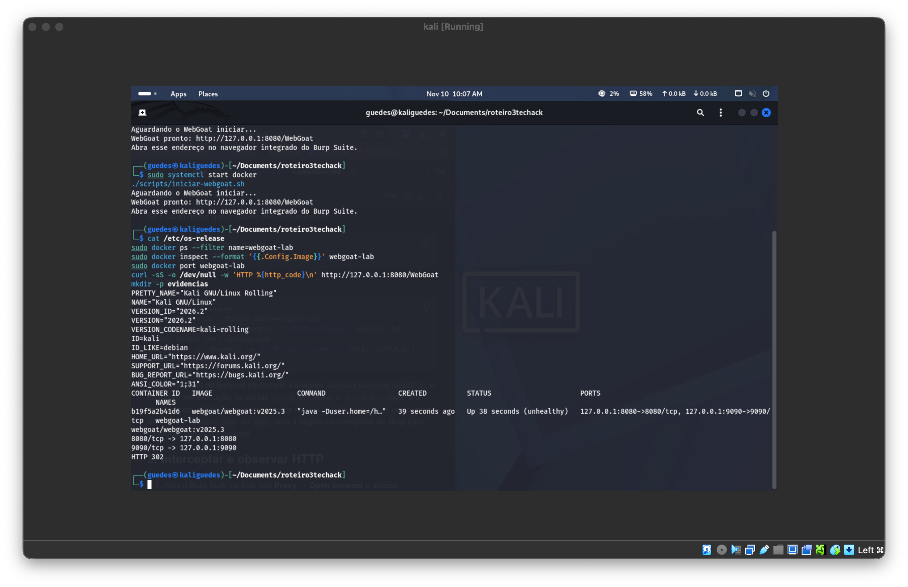

### E02 — Interceptação do GET inicial

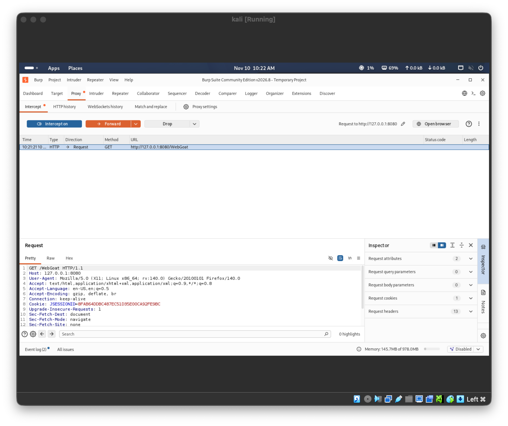

### E03 — Tela de login e resposta HTML

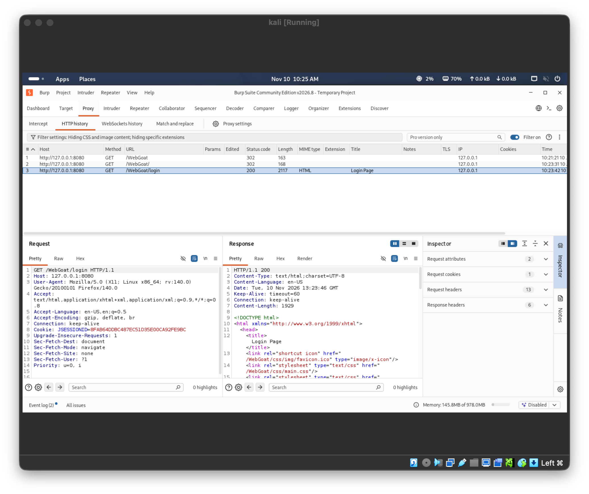

### E04 — Cadastro e emissão de novo cookie

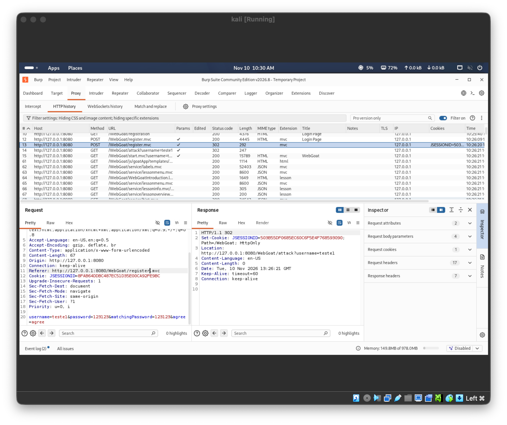

### E05 — Sessão válida no Repeater

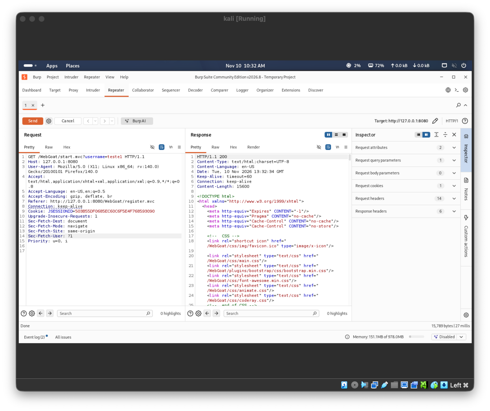

### E06 — Requisição sem cookie

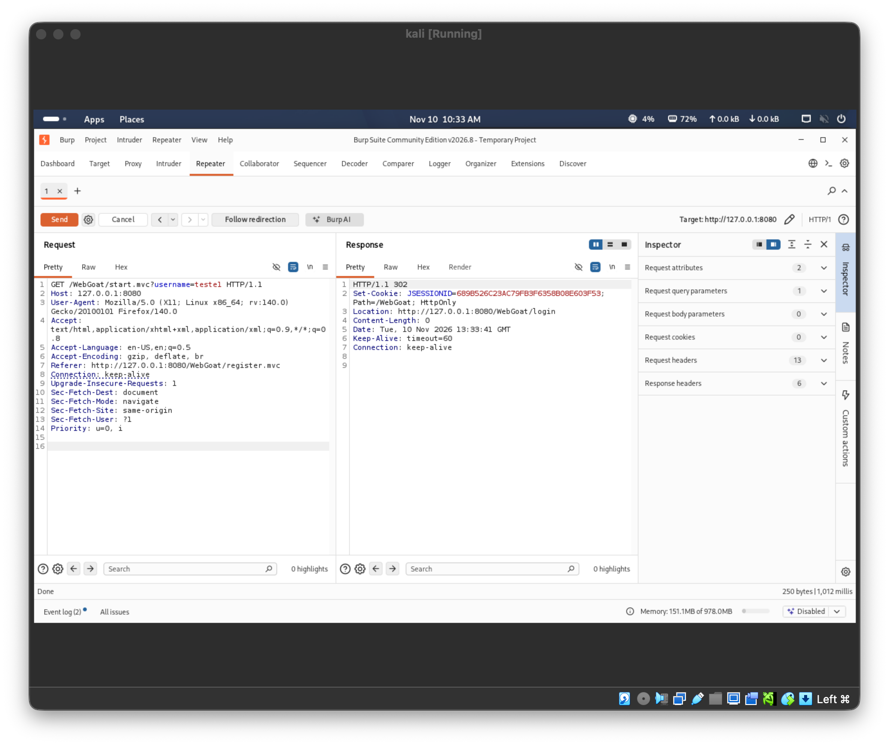

### E07 — Reutilização do cookie após logout

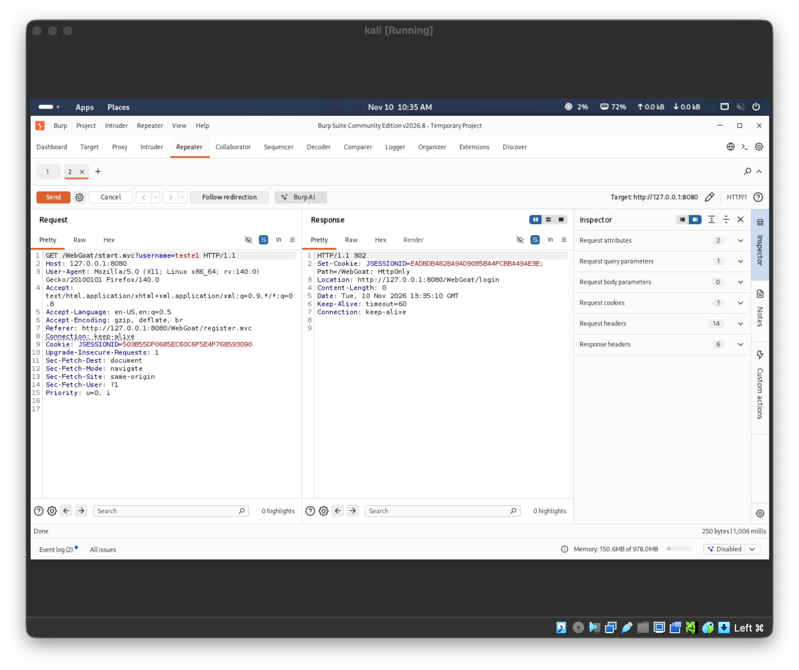

### E08 — JSON do perfil próprio

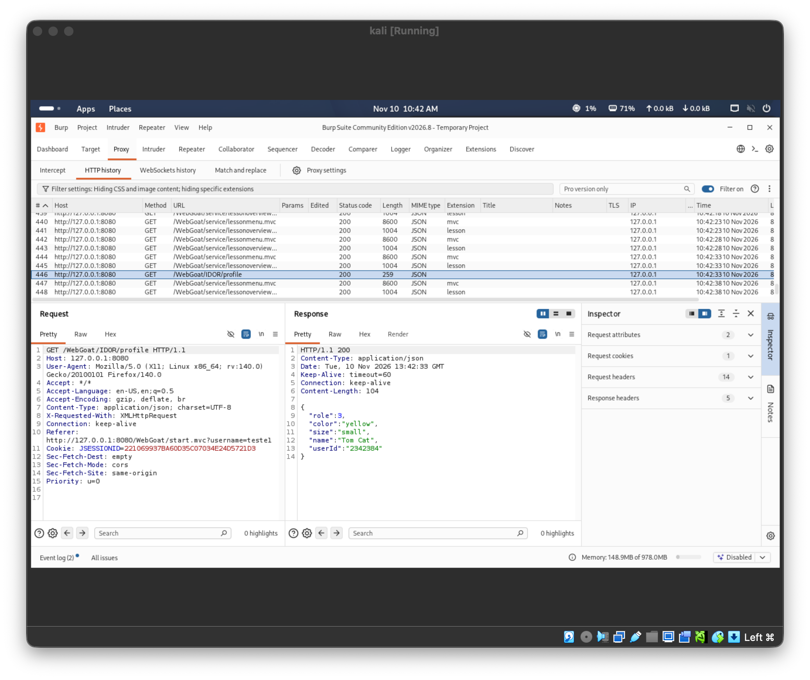

### E09 — Confirmação da rota alternativa

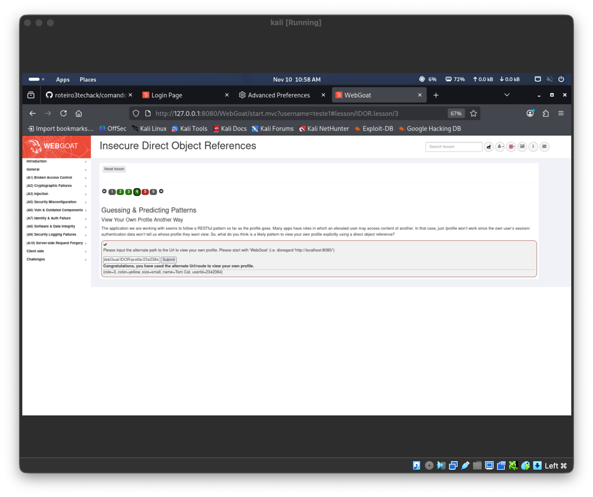

### E10 — Tentativa com ID 2342385

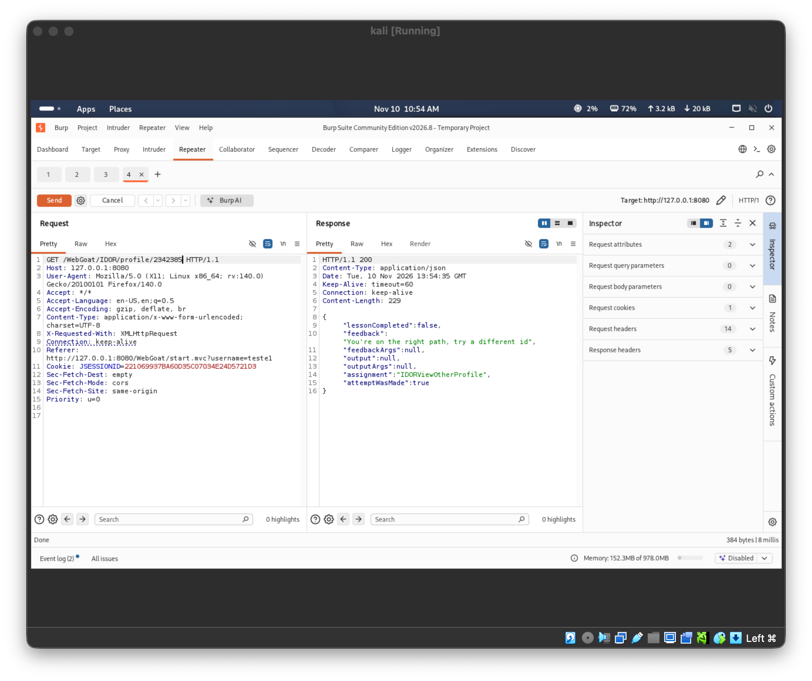

### E11 — Leitura do perfil de Buffalo Bill

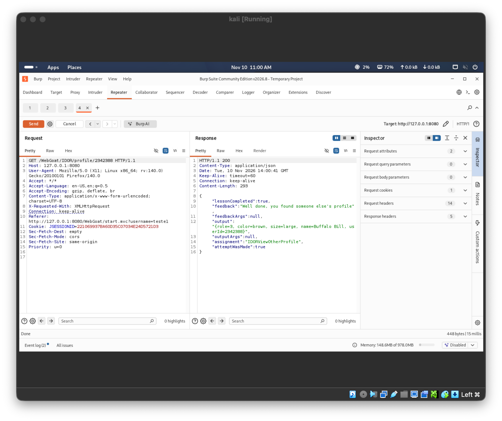

---